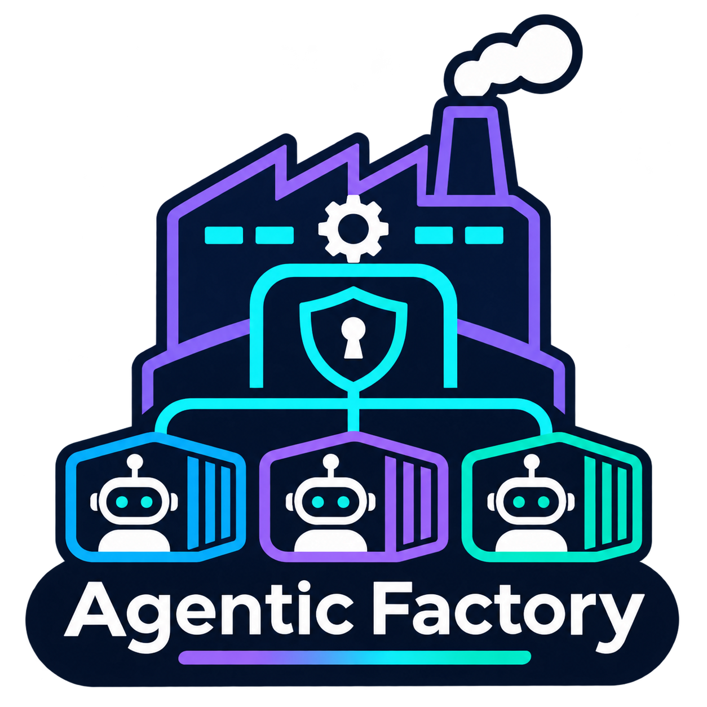

<div align="center">

<!--  -->

# Agentic Factory

### A setup to develop securely using AI agents

[Architecture](#architecture) | [Usage](#usage)

<hr />
</div>

A local, containerized development environment for [Pi](https://github.com/earendil-works/pi),
managed with rootless Podman. Pi runs in a disposable sandbox;
[agentgateway](https://agentgateway.dev/) provides a single endpoint for inference and MCP tools.
All stack configuration lives in this repository, independently of NixOS.

## Architecture

```text
                       +-----------------------+
                       |      Pi sandbox       |
                       |  shell, git, mise     |
                       |  no API credentials   |
                       +-----+------------+----+
                             |            |
                     LLM + MCP|            +----> Public internet
                             |                   (mise, dependencies, git)
                       +-----v-----------+
                       |  agentgateway   |
                       | routing, policy |
                       +----+---------+--+
                            |         |
                      Inference       MCP
                            |         |
                       Providers   MCP containers
                                    (Kubernetes, etc.)
```

| Component          | Responsibility                                                                                                                          |
| ------------------ | --------------------------------------------------------------------------------------------------------------------------------------- |
| **Pi**             | Interactive coding agent with a mounted project workspace, persistent `mise` cache, and direct internet access for development tooling. |
| **agentgateway**   | Central entry point for model inference and MCP tools; holds inference-provider credentials and applies tool policies.                  |
| **MCP containers** | Expose specific capabilities. Each service holds only the credentials it needs (e.g. a read-only Kubernetes kubeconfig).                |
| **Podman Compose** | Starts and connects the containers using rootless Podman; no application configuration in NixOS.                                        |

## Usage

Requires Podman and a Compose provider (e.g. `podman-compose`). Once the Compose stack is
configured:

```sh
# Start the gateway and MCP services
podman compose up -d

# From a project directory, launch an ephemeral Pi session
PI_WORKSPACE="$PWD" podman compose -f /path/to/pi-agent-image/compose.yaml run --rm pi
```

Configure providers and MCP servers in `config/`; keep real credentials in Git-ignored `secrets/`.
Pi points only to agentgateway for inference and MCP, and receives no provider keys or kubeconfigs.
Do not mount the host's `~/.pi` or other credential directories into Pi.

## Security model

Pi runs as a regular user in a rootless container, with passwordless `sudo` available _inside_ the
container for development tooling. Only the selected project workspace and required caches are
mounted. Gateway administration is not exposed to Pi; backend permissions (such as Kubernetes RBAC)
enforce what MCP tools can actually do.

Pi **does have public internet access** for `mise install`, package managers, and Git. Rootless
containers and separate Podman networks reduce exposure but are **not** a hard boundary against
host-reachable internal services or data exfiltration. Do not mount sensitive files; use explicit
egress controls if stronger network isolation is required.

See [ADR 0001](docs/adr/0001-sandbox-and-networking.md) and
[ADR 0002](docs/adr/0002-centralized-gateway.md) for rationale.
