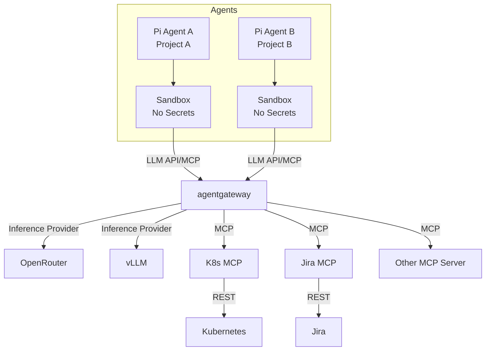

<div align="center">


# Agentic Factory

### A setup to develop securely using AI agents

[Architecture](#architecture) | [Getting Started](#getting-started)

<hr />
</div>

A local environment for running multiple sandboxed AI coding agents with centralized access to
inference providers, tools, and infrastructure.

The core idea is simple: **agents have no credentials or privileged access.** Instead, they interact
with a shared gateway that manages credentials, policies, guardrails, and available capabilities.

The entire environment runs on rootless [Podman](https://podman.io/) and is configured independently
of the host operating system.

## Architecture



- Web fetch, if desired, is installed as a Pi extension. This is an agent capability and should be
  handled by the harness.
- Long term and project specific memory is provided as an MCP. We use plaintext memory for
  simplicity, which is managed within a Podman volume.

## Repository structure

- **compose.yaml** — Podman Compose definition for `agentgateway`, MCP services, and the `pi`
  profile.
- **gateway/** — agentgateway configuration.
- **mcp/** — MCP server configurations.
- **sandbox/** — Builds the Pi agent image via `Dockerfile` and stores config files under `config/`.
- **secrets/** — Provider credentials (`gateway.env`).

### Components

| Component          | Responsibility                                                                                                                                                        |
| ------------------ | --------------------------------------------------------------------------------------------------------------------------------------------------------------------- |
| **Pi sandbox**     | Ephemeral development environment with shell access, persistent tooling caches, and a mounted project workspace. Multiple independent instances can run concurrently. |
| **agentgateway**   | Shared entry point for inference and MCP, providing routing, credentials, tool authorization, policies, and centralized analytics/logging.                            |
| **MCP services**   | Independently deployed containers exposing specific capabilities to agents. Accessible through the gateway, not directly from the agent containers.                   |
| **Podman Compose** | Manages the stack, persistent storage, and isolated container networks.                                                                                               |

### Isolation model

Each agent:

- Runs in a rootless Podman container with no API keys, kubeconfigs, or host credentials.
- Has read/write access to its mounted project workspace and persistent development tooling.
- Can access the internet for development tasks (`mise`, Git, package managers, etc.).
- Uses agentgateway exclusively for inference and centrally managed MCP tools.
- Can use `sudo` inside its container without gaining host root privileges.

MCP services are deployed on a separate backend network and are not directly exposed to the agent
containers. Each service has only the credentials and permissions it requires, such as a Kubernetes
service account with read-only RBAC permissions.

**Security boundary:** This isolates credentials and managed capabilities, but it is not a complete
network sandbox. Agents retain outbound internet access, and mounted workspace files are accessible
to the agent. Stronger restrictions on internal network access require additional egress controls.

<!-- prettier-ignore -->
> [!WARNING]
>Sandboxes are in the same network, meaning agents can technically talk to each other. Moreover,
>agents share the same long-term memory MCP with each agent having access to all memory. Thus, they
>can also communicate over that memory layer even if deployed in isolated networks. DO NOT assume
>isolation between agents.

## MCP Servers

### Current MCP Servers and Their Purposes

The following MCP servers are currently configured along with their purposes:

- **Basic Memory**: Manages long term memory for the agents.
- **ArgoCD**: Manages deployments and application lifecycle for Kubernetes resources.
- **Kubernetes**: Facilitates interaction with Kubernetes clusters, specifically for resource
  management.
- **Atlassian**: Offers integration with Atlassian products like Jira and Confluence.
- **Context7**: Provides up to date documentation of tooling.
- **GitHub**: Get access to private GitHub content.

> In the Gateway, we generally restrict MCP actions to be read-only to enhance security and prevent
> unauthorized modifications.

## Getting Started

### Prerequisites

- Podman (rootless)
- A Compose provider (`podman-compose`)
- Configured inference providers and MCP credentials

### Gateway credentials

Inference provider credentials are managed in `secrets/gateway.env` and injected into agentgateway
through Podman Compose.

For example:

```dotenv
OPENROUTER_API_KEY=your-api-key
```

These environment variables can be referenced in the agentgateway configuration, such as
[in my OpenRouter configuration](https://github.com/f4z3r/agentic-factory/blob/5a05c376d9c508332298bd65beff46b3ad0da68c/gateway/config.yaml#L16-L20).
The `secrets/` directory is excluded from Git and never mounted into agent sandboxes. MCP-specific
credentials are managed separately by their respective services.

### MCP Servers

There are several MCPs configured by default. These are there mostly for reference. You will want to
remove the ones that you do not need. Moreover, for most of them to work (such as GitHub, Atlassian,
and ArgoCD), you will need to provide credentials via the `secrets/` directory. I recommend starting
only with the "Basic Memory" MCP, which will work out of the box.

### Start the infrastructure

From the repository root:

```bash
podman compose up -d
```

This starts agentgateway and the configured MCP services. They remain available across agent
sessions.

The gateway UI is available at [http://localhost:4001/ui/](http://localhost:4001/ui/) for inspecting
configuration, analytics, and request logs.

> **Note:** If the MCPs or agentgateway fail to start, it is likely due to configuration files on
> the system not being world readable. Podman uses a user mapping, so containers cannot read their
> own configuration unless those files are world readable. This does not apply to files under
> `secrets/`, which should have permissions `600`.

### Launch an agent

We dynamically mount host directories in order to ensure that session information and project
specific memory is correctly handled by the harness. Thus we recommend defining the following
functions in your configuration and calling these functions when a sandbox is needed. The functions
will mount your git repository root as the project into the sandbox, or if no git project root is
detected, the current directory. Only directories within your `$HOME` are supported.

For bash:

```bash
pi-sandbox() {
    local root project

    root="$(git rev-parse --show-toplevel 2>/dev/null)" || root="$(pwd -P)"

    case "$root" in
        "$HOME"/*) project="${root#"$HOME"/}" ;;
        *)
            echo "Error: Project must be inside $HOME" >&2
            return 1
            ;;
    esac

    PI_WORKSPACE="$root" \
    PI_PROJECT_NAME="$project" \
        podman compose \
            -f "$HOME/projects/agentic-factory/compose.yaml" \
            --profile agent \
            run --rm pi
}
```

For fish:

```fish
function pi-sandbox
    set -l root (git rev-parse --show-toplevel 2>/dev/null)
    or set root (pwd -P)

    if not string match -q -- "$HOME/*" "$root"
        echo "Error: Project must be inside $HOME" >&2
        return 1
    end

    set -l project (string replace -- "$HOME/" '' "$root")

    env PI_WORKSPACE="$root" PI_PROJECT_NAME="$project" \
        podman compose \
        -f ~/projects/agentic-factory/compose.yaml \
        --profile agent \
        run --rm pi
end
```

Each invocation starts a new isolated Pi session. Run the command from different projects or
terminals to launch multiple agents concurrently, all using the same gateway.

The workspace is mounted read/write, with UID/GID mappings preserving host file ownership.
Development tooling installed through `mise` is cached between sessions.

### Configure capabilities

All configuration is managed centrally in this repository:

- **Inference providers and models:** Configure agentgateway to route requests to the desired
  providers.
- **MCP services:** Add containers to Compose and register them as gateway targets.
- **Policies:** Configure permitted tools and other restrictions in agentgateway.
- **Credentials:** Provide provider secrets to agentgateway and backend credentials to the
  respective MCP services. Never pass them into the Pi sandbox.

Changes to gateway or MCP capabilities do not require rebuilding the Pi image.

For adding new MCP servers, see the [Runbook: Adding MCP servers](docs/runbook-add-mcp-server.md).

For adding new inference providers, see the
[Runbook: Adding Inference Providers](docs/runbook-add-inference-provider.md).

### Stop the infrastructure

```bash
podman compose down
```

Persistent volumes retain development caches and gateway data, including its SQLite analytics and
logging database.

## Design decisions

The reasoning behind the architecture and its security trade-offs is documented in:

- [ADR 0001 — Sandbox and networking](./docs/adr/0001-sandbox-and-networking.md)
- [ADR 0002 — Centralized gateway](./docs/adr/0002-centralized-gateway.md)
- [ADR 0003 — Long term memory](./docs/adr/0003-long-term-memory.md)
